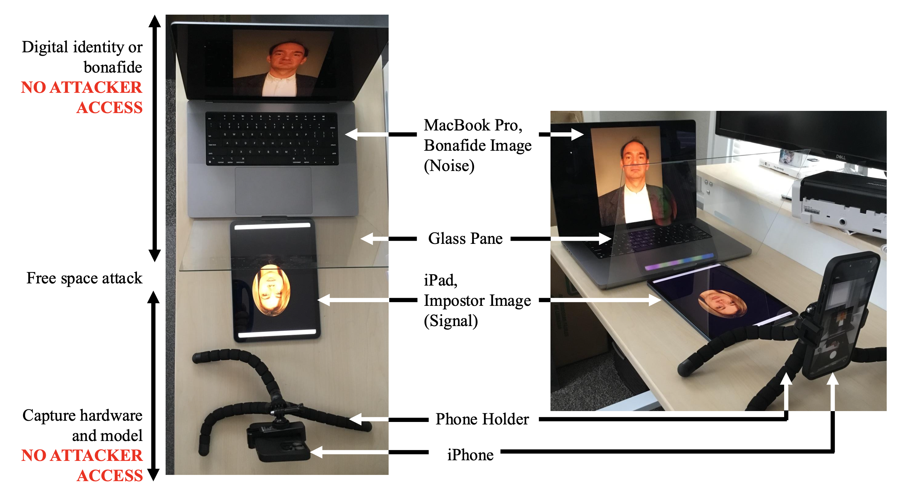
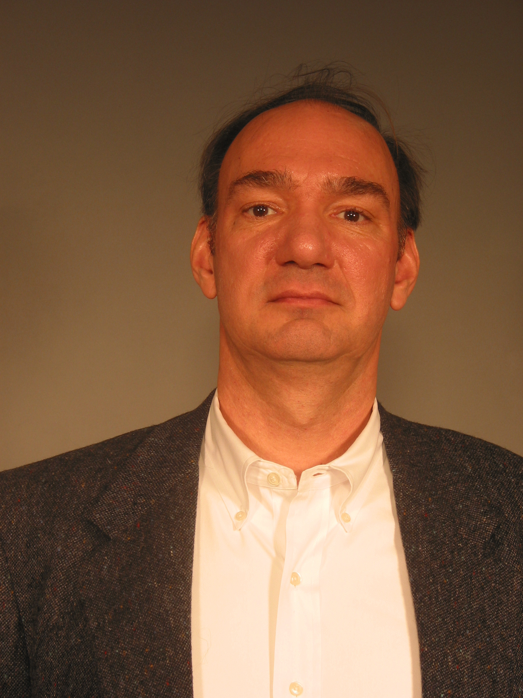
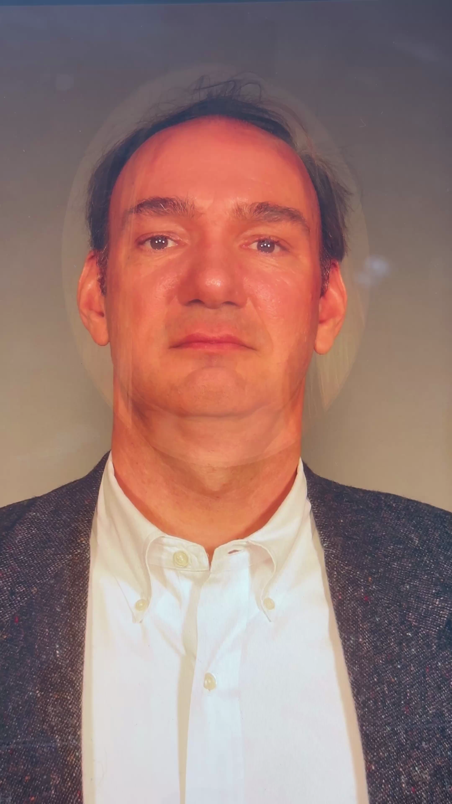
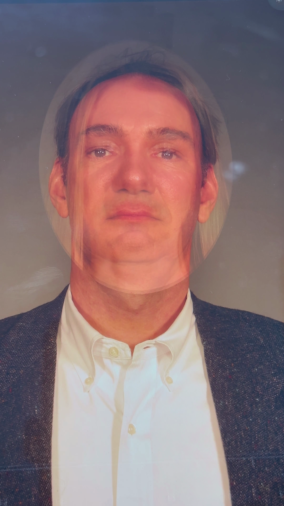
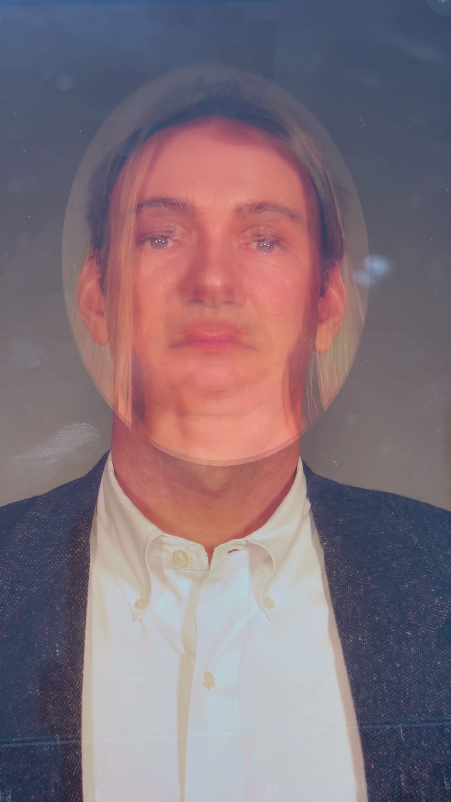
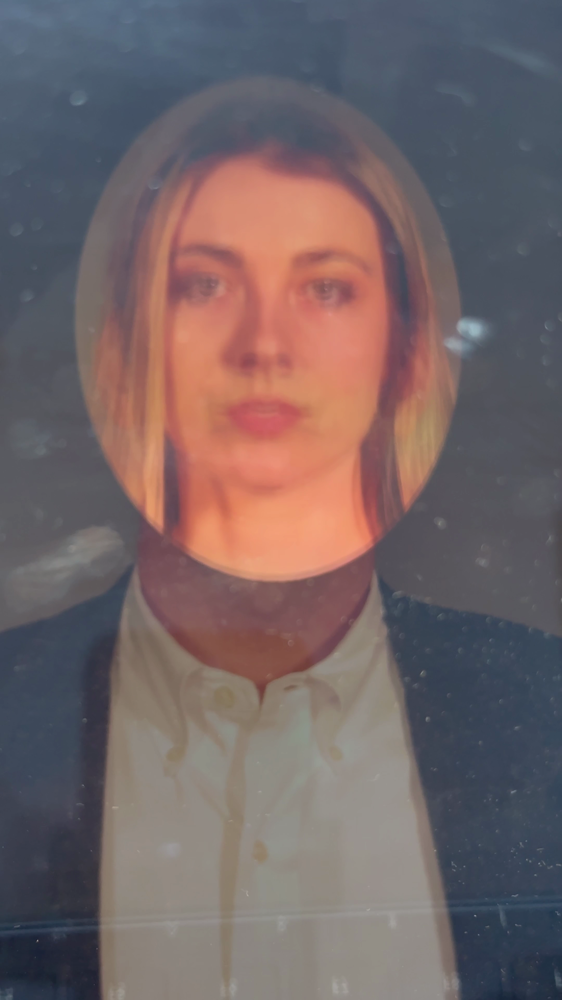
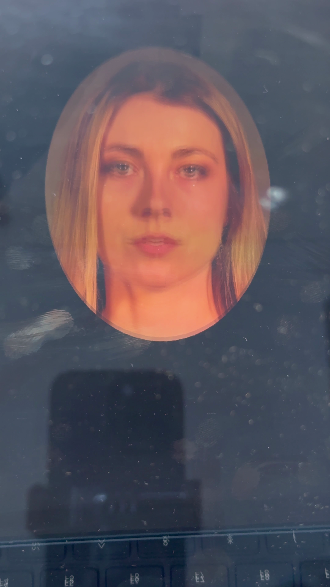

# Ghost Attack: Using 19th-Century Illusions to Fool 21st-Century Biometrics

Official GitHub repository for the paper: Tyler Fitzsimmons and Adam Czajka, "Ghost Attack: Using 19th-Century Illusions to Fool 21st-Century Biometrics," 2027 IEEE/CVF Winter Conference on Applications of Computer Vision (WACV) in Orlando, FL **([ArXiv](https://arxiv.org/html/2610.24238v1) | [IEEEXplore]())**


## Table of contents
* [Abstract](#abstract)
* [Datasets](#datasets)
* [Citation](#citation)
* [Acknowledgment](#acknowledgment)

<a name="abstract"/></a>
## 📌 Abstract

While the Pepper’s Ghost illusion is a 19th-century optical technique, we found that this forgotten gimmick exposes vulnerabilities in modern face recognition systems. This paper introduces the ”Ghost Attack”: a physical attack that repurposes this classic illusion using low-cost, free-space hardware and a transparent medium to project high-resolution facial data into physical 3D space. We show in the paper that despite relying on centuries-old optical principles, this new attack type simultaneously breaks three components of modern facial recognition systems (FRS): (a) the face matcher, (b) the presentation attack detection module, and (c) the morphing attack detection component, resulting in high impersonation success rates against state-of-the-art algorithms without triggering presentation or morphing defenses. These findings reveal a significant blind spot in current biometric systems, which fail to account for transparent projections and evolving physical attack vectors. To support further research, we are offering the dataset of face images of 100 identities, re-captured with and without ”ghost” projections as a new benchmark representing a novel attack for face recognition.

<p align="center">
  
</p>

<a name="datasets"/></a>
## 📀 Datasets

### GhostFace, the Ghost Attack Dataset
GhostFace is comprised of 100 identities, diverse in gender, race, and age. The bonafide identities are single RGB JPEG images of size 1704 x 2272 pixels. The attacked identities are recorded as RGB videos of size 2160 x 3840. Each video is between 12-15 seconds and is comprised of frames with no attack and attack (SNR, also described as attack strength is from 10-100% in 10% intervals). Our evaluations, entirely based on MBGCv2 (Multiple Biometrics Grand Challenge) dataset utilize 100 unique subjects. The entire MBGCv2 dataset consists of almost 10,000 images representing over 500 subjects. If desired, please acquire the original MBGC v2 dataset for full testing purposes. 

Since the attacks are recorded videos we sequentially sampled every five frames, resulting in 8,482 frames across 100 identities. Table 3 uses a subset of the 8,482, where videos were sampled for five frames at 0%, 70%, and 100% attack strength. The 70%-100% attack strength values consist of 20 sampled frames per video (five frames at each level), across all identities.

Our subset was curated to ensure demographic diversity across gender, age, and race, mitigating potential bias in our vulnerability analysis. Since SNR is an important driver for attack success, the attack faces were cropped and the background is set to black pixels (as shown in Fig. 3(b) of the paper). Each of the spoofed identities were displayed on an iPad where brightness was statically set at 100%. The spoofed identities were spatially overlapped to ensure the original or spoofed identities did not dominate one another and the attack was not reliant on a larger face in the scene. The dataset is separated into three groups: selected MBGCv2 images, original cropped, and physically attacked.


<p align="center"> 
  
  
  
  
  
  
  
  <br>
  <i>Attack transition: genuine (a), morph (b) and samples at SNR=1 (c), SNR=1.4 (d), SNR=2 (e), SNR=5 (f), and SNR=10 (g)</i>
</p>


### Obtaining Copies of the Datasets
Researchers interested in obtaining a copy of the data associated with the paper are requested to execute the [data sharing license agreement](). **Note for university licensees:** We cannot accept licenses signed by students or postdoctoral scholars under any circumstances. We cannot accept licenses signed by faculty members unless they have been explicitly delegated the authority to make contracts on behalf of the institution. Your institution's legal or contracting office must review and execute the license. 


<a name="citation"/></a>
### Citation

If you find this work useful in your research, please cite the following paper:
```
@inproceedings{fitzsimmonsWACV2027,
      title={Ghost Attack: Using 19th-Century Illusions to Fool 21st-Century Biometrics}, 
      author={Tyler Fitzsimmons and Adam Czajka},
      year={2027},
      booktitle={IEEE/CVF Winter Conference on Applications of Computer Vision (WACV), Orlando, Florida, January 4-8, 2027},
}
```

<a name="acknowledgment"/></a>
### Acknowledgment
This material is based upon work partially supported by the OUSW/R\&E (Office of the Under Secretary of War, Research and Engineering), National Defense Education Program (NDEP) SMART Scholarship Program, and Naval Surface Warfare Center (NSWC), Crane Division Ph.D. Fellowship Program. Any opinions, findings, and conclusions or recommendations expressed in this material are those of the authors and do not necessarily reflect the views of the DoW or U.S. Navy.
